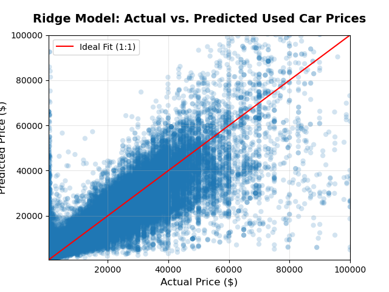
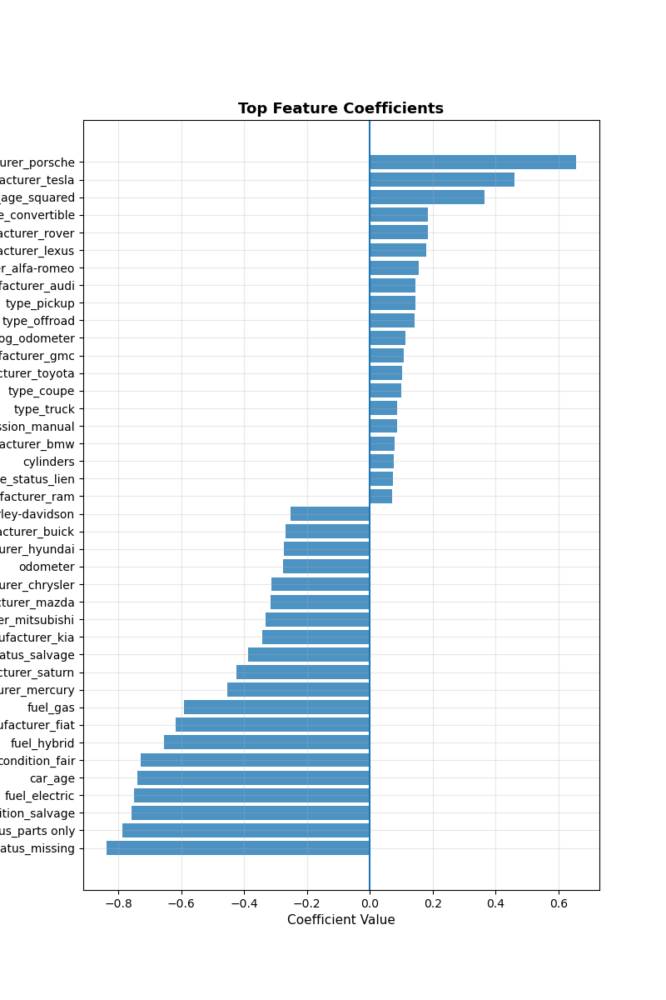

# What drives the price of a car?

## Overview

This project analyzes uses a dataset of **426,880 used-car listings**. Our business goal is to give a used car dealership guidance for choosing inventory and prices by determining important features that drive or depress prices for the consumer as well as a model that can be used as a sanity check.

The Jupyter notebook that goes through understanding, preparing and modeling of our data can be found [`here`](prompt_II.ipynb).

## Data and Approach

- **Data:** data/vehicles.csv 
- **Target:** price -> log(1+price) because of right skewed price
- **Cleaning:** Removed listings with prices outside **$500–$100,000**, model years outside **1980–2022**, and odometer readings above **300,000 miles**. I also removed features that weren't necessary like `VIN`, `Year` and `Region` as they were not necessary.  
- **Feature engineering:** Vehicle age, age squared, log odometer, mileage per year, and a numeric cylinders column.
- **Preprocessing:** dummy encoder on categorical and scaling on numerical
- **Models:** Dummy mean baseline, OLS linear regression, Ridge regression, and Lasso regression.
- **Validation:** 80/20 train/test split and 3-fold cross-validation.
- **Primary metric:** RMSE on `log(1 + price)`, because price is right-skewed. Dollar MAE is reported as a business-friendly secondary metric.

## Model Results

| Model | Test RMSE (log price) | CV RMSE (log price) | Test MAE ($) |
|---|---:|---:|---:|
| Dummy (mean) | 0.9000 | - | $11,234 |
| OLS | 0.4902 | 0.489 | $4,260 |
| Ridge (alpha=10.0) | 0.4904 | 0.492 | $4,270 |
| Lasso | 0.5031 | 0.498 |  $4,672 |
| Ridge (tuned, alpha=10.0) | **0.4902** | **-** | **$4,260** |

The Ridge model achieves a stable Test RMSE of **0.49**, reducing the typical dollar error from roughly **$11,230** down to about *$4,260* compared to the baseline.

### Graphs for Model Accuracy and coefficients

  
  

The above findings show how well our model performed on our test data and our top coefficients that drive or depress prices 

## Key Findings
The tuned Ridge model beats the mean-price baseline. The typical dollar error is roughly **$4,270**. For our client, this model is useful as a sanity check and for relative pricing, but not a substitute for real appraisal.

1. **Age and mileage are consistent price depressors.** Though it's to be noted that with car_age_squared, eventually depreciation stops and classic cars can increase value.
2. **Condition and title status depress price** the worse the car's condition and title status the penalty to the cars value is significant. 
3. **Brands matter** Luxury brands as Porche, Tesla, Rover, and Alpha Romeo drive up the price, whereas budget brands such as Mitsubishi, Hyundai, and Kia drive down the price. There are some interesting notes about brands such as toyota which aren't typically considered a luxery brand, however it drives prices up which could be due to reliability.
4. **offroad, pickup, and convertable drive prices** Offroad and pickup are more expensive than other types most likely because of the utility they provide and the mechanics needed for that could drive up the base price. Convertables are associated with sports cars which are close to luxery, so it makes sense to drive the price.

## Recommendations for the Dealership

- **Stock late-model, low-mileage, clean-title vehicles.** These are the variables with the most reliable price drivers. So a dealership should look for vehicles with clean titles and excellent/good condition.

- **Stock high-demand body styles and models.** Pickups, trucks, SUVs, convertibles hold value better than economy style vehicles.

- **Treat salvage, fair, and parts-only vehicles as discount inventory.** The model estimates large price penalties for these vehicles, so only buy for low value and low volume to sell to more budget friendly buyers.
- - Also note that some of the cars will not have a title or condition label that accurately reflects the severity of the issues that could decrease price, so only buy much lower because of the risk.  

- **Use the model as sanity check, not to appraise vehicles** The model explains about 49% of price variation with a typical error of roughly $4,270. So you can use it to flag overpriced or underpriced listings, then confirm with condition, service history, and local market checks.

## Next Steps

- Add features that are not in the dataset such as: accident history, service records, trim, engine, options, photos, number of owners, days on market.
- Test more advanced models.
- Validate the model on the dealership's own transaction prices and monitor it over time.

## Limitations

The data is just  **listing prices**, not sale prices, not everyone is going to list cars for the market value, which is why days listed would be a great feature that's missing. The model is a decision-support tool, not a replacement for appraisal from a professional, which requires thorough skilled investigation.
